

-7cc4e8?style=flat-square)

 

  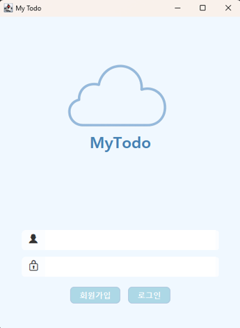
  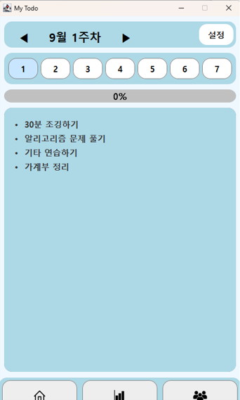
  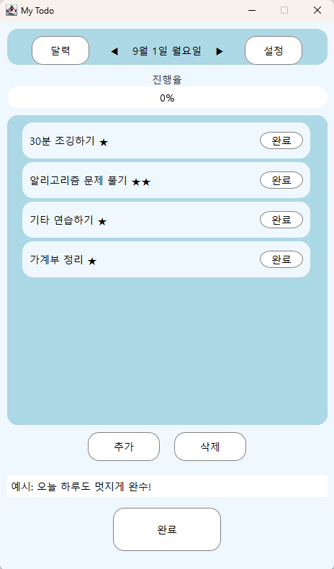
  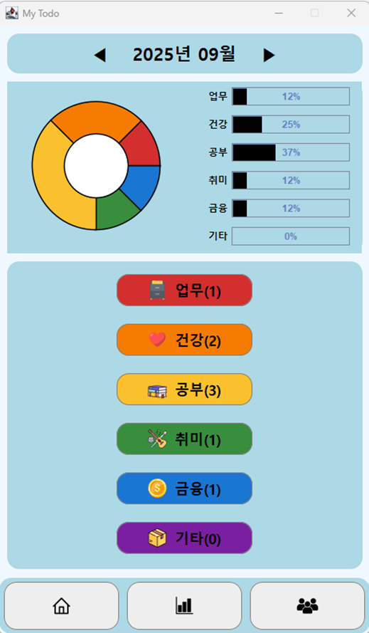

## 📌 프로젝트 소개

**My Todo**는 내 일정을 관리하는 것에서 끝나지 않고, **그룹원과 일정을 공유**하고 **진행률과 통계**로 생산성을 확인할 수 있는 Java 데스크톱 일정 관리 애플리케이션입니다.
팀 **컴파일(Compile)**의 1차 프로젝트로, 이후 2차 프로젝트 [암호화폐 모의투자 플랫폼 COMPILE](https://github.com/doyoung040257/Crypto_Project)로 이어졌습니다.

### 🎯 목표
- 사용자의 **개인 일정 관리**
- 다양한 사용자와 **일정 공유**
- **진행률과 통계**로 생산성 향상
- 다양한 **설정**으로 사용자 경험 맞춤화

 

## ✨ 주요 기능

| 영역 | 기능 |
|---|---|
| 🔐 **사용자 인증 · 관리** | 로그인, 회원가입(아이디 중복 확인, 비밀번호 확인, 성별, 이메일 도메인 선택), 사용자 데이터 관리 |
| 📅 **캘린더 · 할 일** | 주간 · 월간 캘린더, 날짜별 할 일 목록과 진행률(%), 할 일 추가 · 수정 · 삭제 · 완료 처리 |
| ⭐ **할 일 상세** | 그룹(카테고리) · 날짜 · 시간 · 중요도(별 1~3개) · 메모 입력 |
| 📊 **월간 통계** | 카테고리별(업무 · 건강 · 공부 · 취미 · 금융 · 기타) 비율을 도넛 차트와 막대로 표시, 카테고리를 누르면 해당 할 일 목록 보기 |
| 👥 **그룹** | 그룹 만들기 · 삭제, 멤버 목록, 그룹원의 하루 일정을 시간표로 보기 |
| ⚙️ **설정** | 테마(블루 · 핑크 · 다크), 글꼴 이름 · 크기 · 굵기, 알림 켜기/끄기, 개인정보 수정, 로그아웃 |

 

## 🖥️ 화면

### 로그인 · 회원가입

  
  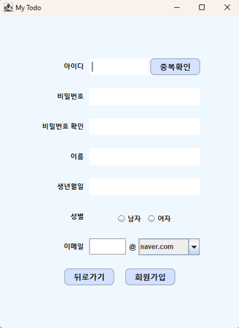

### 메인(홈) · 일일 페이지

  
  

### ✏️ 할 일 추가 · 수정 (담당)

  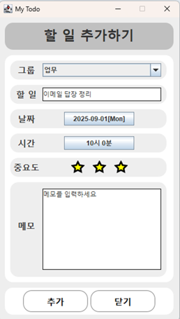
  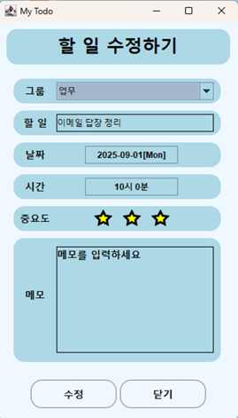

### 📊 통계 페이지 (담당)

  
  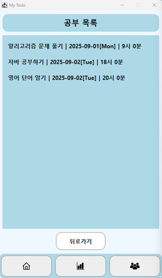

### 그룹 페이지

  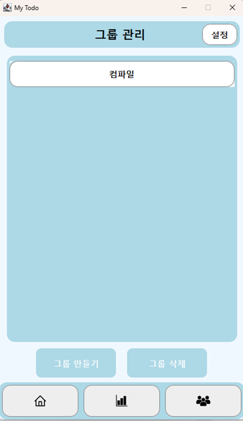
  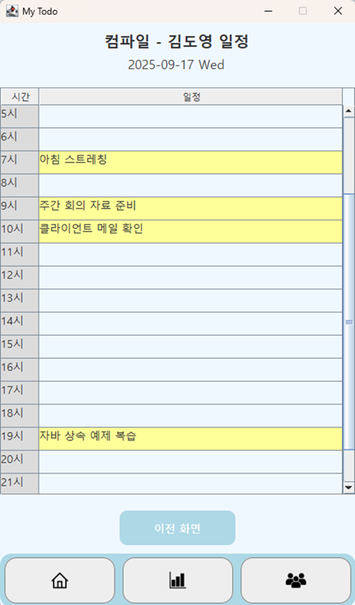
  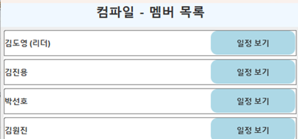

### 설정 페이지

  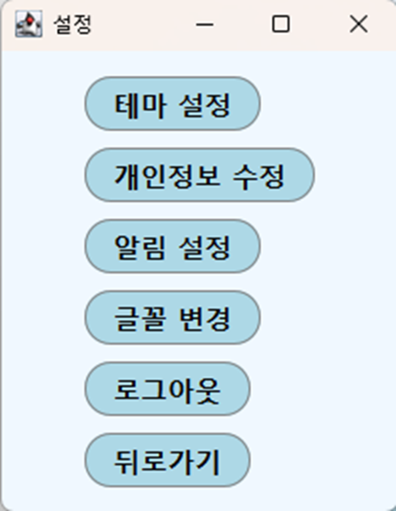
  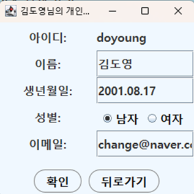

  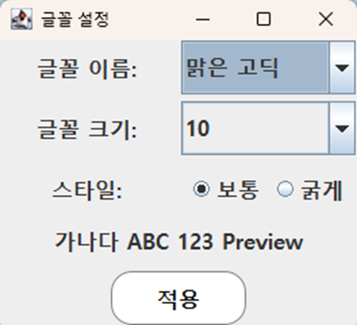
  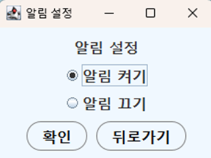

<b>🎨 테마 3종 (블루 · 핑크 · 다크) 보기</b>

 
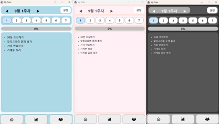

 

## 🛠️ 기술 스택

| 구분 | 기술 |
|---|---|
| **Language** | Java |
| **GUI** | Java Swing |
| **IDE** | Eclipse |
| **Collaboration** | 기능별 회의, 코드 리뷰 |

 

## 👥 팀원 및 역할

| 이름 | 담당 |
|---|---|
| **김도영 (팀장)** | 할 일 추가 · 삭제 페이지, 통계 페이지, 프로젝트 전반 조율 |
| 김진용 · 김원진 | 메인 페이지, 캘린더 페이지, 일일 페이지 |
| 박선호 | 설정 페이지 |
| 김민서 | 로그인 · 회원가입 페이지, PPT 제작 |
| 김현준 | 그룹 페이지 |

### 🙋 내가 맡은 부분 (김도영)

- **할 일 추가 · 수정 · 삭제**: 그룹(카테고리), 할 일, 날짜, 시간, 중요도(별 1~3개), 메모를 입력하는 화면을 만들고, 추가한 할 일이 일일 · 주간 화면에 반영되도록 연결했습니다.
- **월간 통계**: 한 달 동안의 할 일을 카테고리별로 집계해 도넛 차트와 비율 막대로 보여주고, 카테고리 버튼을 누르면 해당 할 일 목록(제목 · 날짜 · 시간)을 보여줍니다.
- **팀장**: 팀원들이 만든 기능을 하나로 연결하는 과정에서 구현 방향이 서로 달라 어려움이 있었습니다. 기능별 회의와 코드 리뷰로 구조를 함께 점검하고 계속 피드백하며 차이를 좁혔습니다.

 

## 🧩 개선할 점

**기능적 개선**
| 영역 | 개선 방향 |
|---|---|
| 우선순위 · 중요도 | 월간 · 주간 캘린더에서도 중요도 표시 |
| 통계 · 시각화 | 완료된 항목도 통계에서 확인 가능하게 |
| 그룹 | 그룹원 추가 시 승인 요청과 알림 |

**기술적 개선**
| 영역 | 개선 방향 |
|---|---|
| 객체지향 설계 | 기능과 역할에 따라 클래스를 더 명확하게 분리 |
| 데이터 저장 | 안정적인 데이터 관리를 위해 DB 도입 |

### 💡 느낀 점
기획 단계에서 세부 구조를 충분히 논의하지 않아 기능을 연결하는 데 시간이 걸렸습니다. 이 경험으로 **구현 전에 기능 흐름과 데이터 구조를 먼저 정리**하는 것이 중요하다는 걸 배웠습니다

